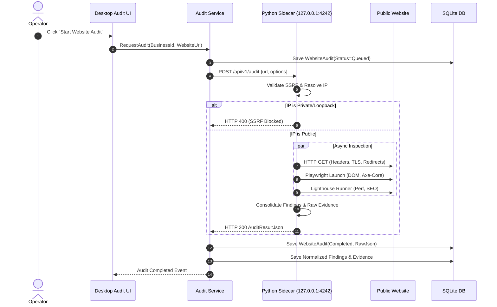
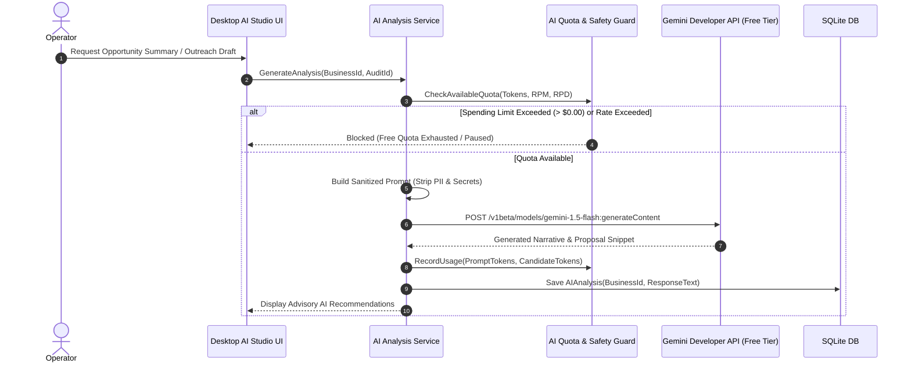
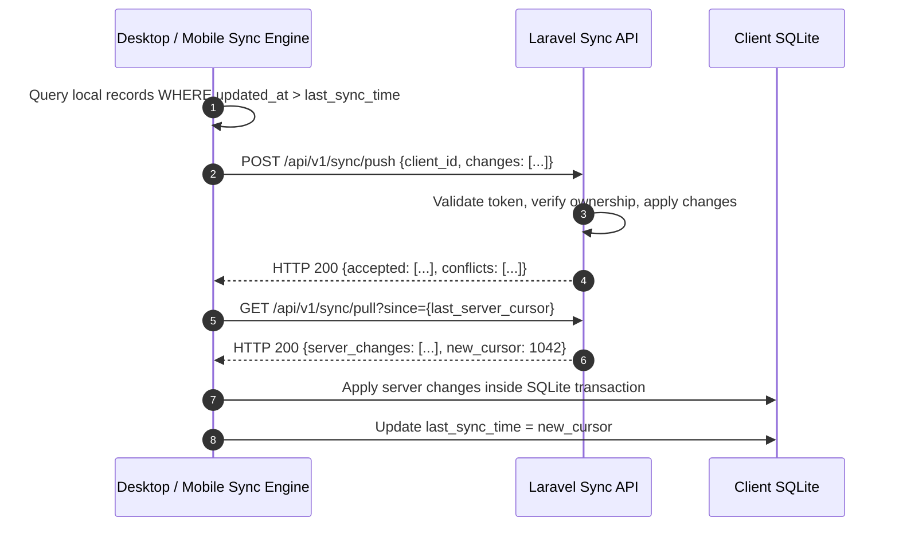

# TKS LeadPilot — Comprehensive Architecture Specification

**Document Version:** 1.0.0  
**Status:** Approved Architecture (Stage 1)  
**Author:** Antigravity AI  
**Owner:** TheKhanSoft  

---

## 1. System Architecture Overview

TKS LeadPilot follows a **Local-First Hybrid Architecture**. The Windows Desktop client and the Android Mobile client each operate autonomously against local SQLite databases. The central Laravel API is an optional synchronization and central administration hub. The Python Audit Engine runs as an out-of-process local sidecar service.

```mermaid
flowchart TB
    subgraph DesktopClient["Windows Desktop (Primary Station)"]
        UI_Desk["Avalonia UI 11/12 (XAML / C#)\nMaterial/Fluent Theme"]
        VM_Desk["ViewModels (CommunityToolkit.Mvvm)"]
        BL_Desk["Domain Services & Lead Scorer"]
        Repo_Desk["Repository Layer"]
        DB_Desk[("Local SQLite Database\nEF Core 10")]
        Sec_Desk["Windows DPAPI Secret Store"]
        Sync_Desk["Delta Sync Engine (Desktop)"]
        Sidecar_Client["Sidecar IPC Client (HTTP/JSON-RPC)"]
        Gemini_Desk["Gemini Free-Tier Client"]
    end

    subgraph MobileClient["Android Mobile (Field Companion)"]
        UI_Mob["Flutter UI (Material 3 / Dart)"]
        State_Mob["Riverpod Providers & Controllers"]
        Repo_Mob["Repository Layer"]
        DB_Mob[("Local SQLite Database\nDrift ORM")]
        Sec_Mob["Flutter Secure Storage (Keystore)"]
        Sync_Mob["Delta Sync Engine (Mobile)"]
    end

    subgraph AuditSidecar["Python Audit Sidecar (Local Process)"]
        FastAPI_Svr["FastAPI / Uvicorn Server\n(Localhost Port 4242)"]
        SSRF_Guard["SSRF & DNS Rebind Guard"]
        Crawler_Mod["Async HTTP Crawler"]
        Playwright_Mod["Playwright Chromium Browser"]
        Lighthouse_Mod["Lighthouse CLI Engine"]
        Axe_Mod["axe-core Accessibility Evaluator"]
    end

    subgraph CentralServer["Optional Central Backend (server/)"]
        Lara_API["Laravel 12 REST API\n(PHP 8.4)"]
        Sanctum_Auth["Sanctum Auth & Policy Gates"]
        Sync_Controller["Sync & Delta Engine"]
        Central_DB[("MySQL 8.4 Database")]
        Central_Queue["Laravel Queue & Scheduler"]
    end

    subgraph ExternalServices["External Providers"]
        Ext_OSM["OpenStreetMap / Overpass API"]
        Ext_Places["Google Places API (Optional)"]
        Ext_Gemini["Google Gemini Developer API\n(Free Tier Only)"]
        Target_Sites["Public Target Websites"]
    end

    %% Desktop Connections
    UI_Desk --> VM_Desk
    VM_Desk --> BL_Desk
    BL_Desk --> Repo_Desk
    Repo_Desk --> DB_Desk
    Repo_Desk --> Sec_Desk
    BL_Desk --> Sidecar_Client
    BL_Desk --> Gemini_Desk
    BL_Desk --> Sync_Desk
    Sidecar_Client <-->|Local Loopback HTTP| FastAPI_Svr
    Gemini_Desk <-->|HTTPS REST| Ext_Gemini
    BL_Desk -->|OSM / Places Adapter| Ext_OSM
    BL_Desk -->|Places Adapter| Ext_Places
    Sync_Desk <-->|HTTPS REST API (Optional)| Lara_API

    %% Mobile Connections
    UI_Mob --> State_Mob
    State_Mob --> Repo_Mob
    Repo_Mob --> DB_Mob
    Repo_Mob --> Sec_Mob
    State_Mob --> Sync_Mob
    Sync_Mob <-->|HTTPS REST API (Optional)| Lara_API

    %% Sidecar Connections
    FastAPI_Svr --> SSRF_Guard
    SSRF_Guard --> Crawler_Mod
    SSRF_Guard --> Playwright_Mod
    Crawler_Mod --> Target_Sites
    Playwright_Mod --> Target_Sites
    Playwright_Mod --> Lighthouse_Mod
    Playwright_Mod --> Axe_Mod

    %% Central Connections
    Lara_API --> Sanctum_Auth
    Lara_API --> Sync_Controller
    Sync_Controller --> Central_DB
    Lara_API --> Central_Queue
```

---

## 2. Platform Technology Stacks

### 2.1 Desktop Client (`desktop/`)
- **Runtime:** .NET 10 SDK (x64)
- **UI Framework:** Avalonia UI 11/12+ (XAML)
- **Architecture Pattern:** MVVM (Model-View-ViewModel) with `CommunityToolkit.Mvvm`
- **Dependency Injection:** `Microsoft.Extensions.DependencyInjection`
- **Data Persistence:** SQLite with `Microsoft.EntityFrameworkCore.Sqlite`
- **Network & HTTP:** `System.Net.Http.HttpClient` with Polly for resilience/retries
- **Local Secret Storage:** Windows DPAPI (`System.Security.Cryptography.ProtectedData`)
- **JSON Serialization:** `System.Text.Json` (Source-generated for maximum speed)
- **Testing:** `xUnit`, `FluentAssertions`, `Moq`, `Avalonia.Headless.XUnit`

### 2.2 Mobile Client (`mobile/`)
- **Runtime:** Flutter 3.47+ / Dart 3.13+
- **Platform:** Android 8.0+ (API level 26+)
- **Design System:** Material 3 with TheKhanSoft Brand Palette
- **State Management:** Riverpod 2.x (`flutter_riverpod`)
- **Navigation:** GoRouter 14.x (`go_router`)
- **Data Persistence:** SQLite with Drift (`drift`, `sqlite3_flutter_libs`)
- **Network & HTTP:** Dio (`dio`) with authentication and retry interceptors
- **Secret Storage:** `flutter_secure_storage` (Android EncryptedSharedPreferences / KeyStore)
- **Testing:** `flutter_test`, `mocktail`

### 2.3 Audit Engine Sidecar (`audit_engine/`)
- **Runtime:** Python 3.13 (x64)
- **API Server:** FastAPI + Uvicorn (Bound to `127.0.0.1:4242`)
- **Headless Browser:** Playwright Chromium (sandboxed)
- **Performance Evaluation:** Google Lighthouse CLI 13.x via Node.js
- **Accessibility:** axe-core runtime injection
- **HTTP Engine:** `httpx` (async, strict timeout control)
- **HTML Parsing:** `beautifulsoup4` + `lxml`
- **Validation:** Pydantic v2

### 2.4 Central Backend (`server/` — Optional Sync Server)
- **Runtime:** PHP 8.4.12
- **Framework:** Laravel 12.x (REST API mode only — zero Blade/Livewire UI)
- **Database:** MySQL 8.4 Community Edition
- **Authentication:** Laravel Sanctum (Bearer Token)
- **Authorization:** Policies & Gates + Spatie Laravel Permission
- **Queues:** Database queue driver for initial simplicity (Redis compatible)
- **Testing:** PHPUnit / Pest with in-memory SQLite

---

## 3. Data Flows & Key Workflows

### 3.1 Business Discovery Flow
```mermaid
sequenceDiagram
    autonumber
    actor User as Operator
    participant UI as Desktop Discovery UI
    participant DiscMgr as Discovery Manager
    participant Adapter as OSM / Places Adapter
    participant Dedup as Deduplication Engine
    participant DB as SQLite DB

    User->>UI: Enter search criteria (City, Category, Keywords)
    UI->>DiscMgr: Create Discovery Job(UUID)
    DiscMgr->>DB: Save DiscoveryJob(Status=Running)
    DiscMgr->>Adapter: ExecuteSearch(criteria, limit)
    Adapter->>Adapter: Validate Rate Limits & Cache
    Adapter-->>DiscMgr: Raw Source Records
    loop For each raw record
        DiscMgr->>Dedup: MatchAgainstExisting(rawRecord)
        alt Confident Duplicate (>90% score)
            Dedup-->>DiscMgr: Existing Match Found (Auto-Link)
        alt Uncertain Duplicate (60-89% score)
            Dedup->>DB: Save DuplicateCandidate(Status=PendingReview)
        else Unique Record
            DiscMgr->>DB: Insert Business + SourceProvenance
        end
    end
    DiscMgr->>DB: Update DiscoveryJob(Status=Completed)
    DiscMgr-->>UI: Discovery Complete Notification
```

### 3.2 Website Audit Flow


### 3.3 Gemini AI Opportunity Analysis (Zero-Billing Policy)


### 3.4 Bidirectional Delta Synchronization Flow


---

## 4. Provider Abstraction Contracts

### 4.1 Discovery Provider Contract (C# / Desktop)
```csharp
public interface IDiscoveryProvider
{
    string ProviderId { get; }
    string DisplayName { get; }
    bool IsConfigured { get; }
    bool IsEnabled { get; }
    Task<ProviderHealthResult> CheckHealthAsync(CancellationToken ct);
    Task<DiscoveryResultBatch> SearchBusinessesAsync(DiscoverySearchCriteria criteria, CancellationToken ct);
    UsageQuotaStats GetQuotaStats();
}
```

### 4.2 AI Provider Contract (C# / Desktop)
```csharp
public interface IAiProvider
{
    string ProviderId { get; }
    string ModelName { get; }
    bool IsZeroCostGuaranteed { get; }
    Task<AiTextResult> GenerateSummaryAsync(BusinessContext context, CancellationToken ct);
    Task<AiTextResult> InterpretAuditFindingsAsync(AuditSummary context, CancellationToken ct);
    Task<AiOutreachDraft> DraftOutreachMessageAsync(OutreachContext context, CancellationToken ct);
    AiQuotaStatus GetQuotaStatus();
    void EmergencyDisable();
}
```

### 4.3 Website Inspector Contract (Python Sidecar)
```python
class IAuditEngine(Protocol):
    async def inspect_website(self, request: AuditRequest) -> AuditResponse:
        ...
    async def check_ssrf(self, target_url: str) -> SSRFCheckResult:
        ...
```

---

## 5. Security Architecture & SSRF Guard

### 5.1 SSRF Defense in Depth
The Python audit sidecar and Desktop HTTP inspector enforce strict SSRF safeguards:
1. **Pre-Flight DNS Resolution:** Destination hostname is resolved to IPv4 and IPv6 addresses.
2. **IP Range Blacklist Verification:** The resolved IP is matched against:
   - Loopback: `127.0.0.0/8`, `::1/128`
   - RFC 1918 Private Networks: `10.0.0.0/8`, `172.16.0.0/12`, `192.168.0.0/16`
   - Link-Local: `169.254.0.0/16`, `fe80::/10`
   - Carrier-Grade NAT: `100.64.0.0/10`
   - Cloud Metadata Endpoints: `169.254.169.254` (AWS, Azure, GCP, DigitalOcean)
   - Broadcast / Multicast: `224.0.0.0/4`, `240.0.0.0/4`
3. **Redirect Pinning:** Every HTTP 301/302 redirect destination URL is evaluated through the identical DNS resolution and blacklist checks before socket connection.
4. **DNS Rebinding Protection:** The connection is made directly to the resolved and verified IP address with the `Host` header set explicitly to the requested domain.

### 5.2 Secret Protection
- **Windows:** Gemini API keys and Places API keys stored in encrypted files using `ProtectedData.Protect` (Windows DPAPI, machine/user bound).
- **Android:** Tokens stored in Android KeyStore via `flutter_secure_storage`.
- **Logs:** RegEx-based sanitization masks API keys (`AIza[0-9A-Za-z-_]{35}`) and bearer tokens across all log sinks.
