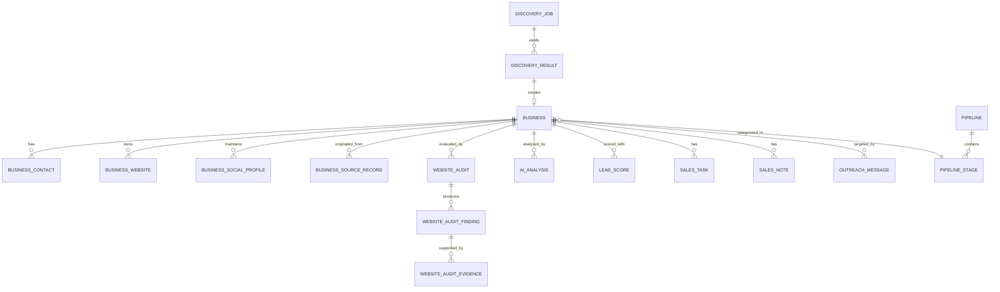

# TKS LeadPilot — Database Design & Schema Specification

**Document Version:** 1.0.0  
**Status:** Approved Specification (Stage 1)  
**Engines:** SQLite 3 (Desktop & Mobile Local) / MySQL 8.4 (Central Server)  
**Primary Key Standard:** RFC 4122 v4 UUID (Text/CHAR(36))  
**Timestamps:** ISO 8601 UTC Strings (`YYYY-MM-DDTHH:MM:SSZ`)  

---

## 1. Design Principles

1. **Client-Generated UUIDs:** Every entity uses a UUIDv4 generated locally upon creation. This eliminates ID collisions when syncing across multiple desktop and mobile devices.
2. **Identical Local & Remote Schemas:** SQLite and MySQL share the exact same entity definitions, column names, nullability constraints, and relationships.
3. **Soft Deletes for Sync Idempotency:** Deleted records are flagged with `is_deleted = 1` and `deleted_at = TIMESTAMP` to generate sync tombstones.
4. **Optimistic Concurrency & Revision Vectors:** Every syncable table contains `version INTEGER NOT NULL DEFAULT 1` and `client_updated_at TIMESTAMP NOT NULL`.
5. **Raw Provenance Isolation:** Raw source payloads from external APIs (OSM, Places, CSV) are stored separately in `business_source_records` to prevent schema pollution.

---

## 2. Entity Relationship Overview

---

## 3. Core Tables Specification

### 3.1 Business Core (`businesses`)

| Column | Type | Constraints | Description |
|---|---|---|---|
| `id` | TEXT(36) | PRIMARY KEY | Client UUIDv4 |
| `name` | TEXT(255) | NOT NULL | Normalized business name |
| `legal_name` | TEXT(255) | NULL | Official registered name |
| `category` | TEXT(100) | NOT NULL | Primary category (e.g., 'Restaurant', 'Clinic') |
| `subcategory` | TEXT(100) | NULL | Specific niche |
| `description` | TEXT | NULL | Business summary / bio |
| `address_line1` | TEXT(255) | NULL | Street address |
| `address_line2` | TEXT(255) | NULL | Suite / Floor |
| `locality` | TEXT(100) | NULL | Neighborhood / Area |
| `city` | TEXT(100) | NOT NULL | City |
| `state_province`| TEXT(100) | NULL | State or Province |
| `postal_code` | TEXT(20) | NULL | Postal / ZIP code |
| `country` | TEXT(100) | NOT NULL DEFAULT 'Pakistan' | Country |
| `latitude` | REAL | NULL | Geographic coordinate |
| `longitude` | REAL | NULL | Geographic coordinate |
| `phone_primary` | TEXT(50) | NULL | Primary contact phone |
| `email_primary` | TEXT(255) | NULL | Public business email |
| `website_url` | TEXT(500) | NULL | Canonical website URL |
| `pipeline_stage_id` | TEXT(36) | NOT NULL | FK to `pipeline_stages.id` |
| `lead_score` | INTEGER | NOT NULL DEFAULT 0 | Current composite score (0-100) |
| `lead_status` | TEXT(50) | NOT NULL DEFAULT 'Discovered' | Quick status indicator |
| `tags` | TEXT | NULL | Comma-separated or JSON array of tags |
| `is_starred` | INTEGER | NOT NULL DEFAULT 0 | User bookmark flag (0 or 1) |
| `is_deleted` | INTEGER | NOT NULL DEFAULT 0 | Soft delete flag |
| `created_at` | TEXT | NOT NULL | ISO 8601 UTC timestamp |
| `updated_at` | TEXT | NOT NULL | ISO 8601 UTC timestamp |
| `deleted_at` | TEXT | NULL | ISO 8601 UTC timestamp |
| `version` | INTEGER | NOT NULL DEFAULT 1 | Sync revision counter |

**Indexes:**
- `idx_businesses_city_category` (`city`, `category`)
- `idx_businesses_lead_score` (`lead_score` DESC)
- `idx_businesses_pipeline_stage` (`pipeline_stage_id`)
- `idx_businesses_website_url` (`website_url`)
- `idx_businesses_updated_at` (`updated_at`)

---

### 3.2 Business Contacts (`business_contacts`)

| Column | Type | Constraints | Description |
|---|---|---|---|
| `id` | TEXT(36) | PRIMARY KEY | Contact UUID |
| `business_id` | TEXT(36) | NOT NULL, FK `businesses.id` | Owning business |
| `full_name` | TEXT(255) | NOT NULL | Contact person name |
| `job_title` | TEXT(100) | NULL | Position (Owner, Manager, Doctor) |
| `email` | TEXT(255) | NULL | Direct email address |
| `phone` | TEXT(50) | NULL | Direct phone / mobile |
| `whatsapp_number`| TEXT(50) | NULL | Verified WhatsApp number |
| `is_primary` | INTEGER | NOT NULL DEFAULT 0 | Primary outreach contact |
| `consent_status`| TEXT(50) | NOT NULL DEFAULT 'Unknown' | `Consented`, `Unknown`, `OptedOut` |
| `created_at` | TEXT | NOT NULL | ISO 8601 UTC |
| `updated_at` | TEXT | NOT NULL | ISO 8601 UTC |

---

### 3.3 Website Audits (`website_audits`)

| Column | Type | Constraints | Description |
|---|---|---|---|
| `id` | TEXT(36) | PRIMARY KEY | Audit UUID |
| `business_id` | TEXT(36) | NOT NULL, FK `businesses.id` | Audited business |
| `target_url` | TEXT(500) | NOT NULL | Audited canonical URL |
| `audit_status` | TEXT(50) | NOT NULL | `Queued`, `Running`, `Completed`, `Failed` |
| `perf_score` | INTEGER | NULL | Lighthouse Performance (0-100) |
| `seo_score` | INTEGER | NULL | Lighthouse SEO (0-100) |
| `a11y_score` | INTEGER | NULL | Lighthouse/Axe Accessibility (0-100) |
| `security_score`| INTEGER | NULL | Security Hygiene Score (0-100) |
| `raw_report_json`| TEXT | NULL | Full JSON payload from sidecar |
| `error_message` | TEXT | NULL | Execution error details |
| `completed_at` | TEXT | NULL | Timestamp of completion |
| `created_at` | TEXT | NOT NULL | ISO 8601 UTC |

---

### 3.4 Website Audit Findings (`website_audit_findings`)

| Column | Type | Constraints | Description |
|---|---|---|---|
| `id` | TEXT(36) | PRIMARY KEY | Finding UUID |
| `audit_id` | TEXT(36) | NOT NULL, FK `website_audits.id` | Parent audit |
| `category` | TEXT(50) | NOT NULL | `Performance`, `SEO`, `Accessibility`, `Security`, `Conversion` |
| `severity` | TEXT(20) | NOT NULL | `Critical`, `High`, `Medium`, `Low`, `Info` |
| `rule_code` | TEXT(100) | NOT NULL | e.g. `MISSING_HTTPS`, `SLOW_LCP`, `NO_ALT_TAGS` |
| `title` | TEXT(255) | NOT NULL | Short finding summary |
| `description` | TEXT | NOT NULL | Detailed explanation |
| `evidence_text` | TEXT | NULL | Specific measured value |
| `recommended_fix`| TEXT | NULL | Actionable fix advice |
| `business_impact`| TEXT | NULL | Plain English business reason to resolve |
| `created_at` | TEXT | NOT NULL | ISO 8601 UTC |

---

### 3.5 AI Analyses (`ai_analyses`)

| Column | Type | Constraints | Description |
|---|---|---|---|
| `id` | TEXT(36) | PRIMARY KEY | Analysis UUID |
| `business_id` | TEXT(36) | NOT NULL, FK `businesses.id` | Target business |
| `audit_id` | TEXT(36) | NULL, FK `website_audits.id` | Associated audit |
| `task_type` | TEXT(50) | NOT NULL | `OpportunitySummary`, `OutreachDraft`, `ServiceProposal` |
| `model_used` | TEXT(100) | NOT NULL | e.g. `gemini-1.5-flash-free` |
| `prompt_tokens` | INTEGER | NOT NULL DEFAULT 0 | Token count |
| `response_tokens`| INTEGER | NOT NULL DEFAULT 0 | Token count |
| `summary_text` | TEXT | NOT NULL | Generated advisory text |
| `recommended_services`| TEXT | NULL | JSON array of recommended service IDs |
| `cost_incurred` | REAL | NOT NULL DEFAULT 0.00 | Always 0.00 (verified) |
| `created_at` | TEXT | NOT NULL | ISO 8601 UTC |

---

### 3.6 Sales Tasks & Notes (`sales_tasks`, `sales_notes`)

| Column | Type | Constraints | Description |
|---|---|---|---|
| `id` | TEXT(36) | PRIMARY KEY | Task UUID |
| `business_id` | TEXT(36) | NOT NULL, FK `businesses.id` | Target business |
| `title` | TEXT(255) | NOT NULL | Task description |
| `due_date` | TEXT | NULL | Due date (ISO 8601) |
| `priority` | TEXT(20) | NOT NULL DEFAULT 'Medium' | `Low`, `Medium`, `High`, `Urgent` |
| `is_completed` | INTEGER | NOT NULL DEFAULT 0 | Completion status |
| `assigned_user` | TEXT(100) | NULL | Assignee |
| `created_at` | TEXT | NOT NULL | ISO 8601 UTC |

---

### 3.7 Outreach Messages (`outreach_messages`)

| Column | Type | Constraints | Description |
|---|---|---|---|
| `id` | TEXT(36) | PRIMARY KEY | Message UUID |
| `business_id` | TEXT(36) | NOT NULL, FK `businesses.id` | Target business |
| `contact_id` | TEXT(36) | NULL, FK `business_contacts.id` | Recipient contact |
| `channel` | TEXT(20) | NOT NULL | `Email`, `WhatsApp` |
| `subject` | TEXT(255) | NULL | Subject line (email) |
| `body` | TEXT | NOT NULL | Complete rendered message body |
| `approval_status`| TEXT(30) | NOT NULL DEFAULT 'PendingApproval' | `PendingApproval`, `Approved`, `Rejected` |
| `approved_by` | TEXT(100) | NULL | Approving operator name |
| `approved_at` | TEXT | NULL | Approval timestamp |
| `dispatch_status`| TEXT(30) | NOT NULL DEFAULT 'Draft' | `Draft`, `Queued`, `Sent`, `Failed` |
| `created_at` | TEXT | NOT NULL | ISO 8601 UTC |
