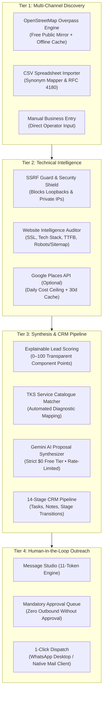

# TKS LeadPilot — Comprehensive Operator Manual & User Guide

> **Enterprise Business Discovery, Technical Website Intelligence, AI Proposal Synthesis & Multi-Channel CRM Platform**  
> **Prepared for:** TheKhanSoft (TKS) Operations, Business Development & Technical Sales Teams  
> **Version:** 1.0.0 (Release Edition)  
> **Classification:** Internal Commercial Use  

---

## 1. System Overview & Core Principles

**TKS LeadPilot** is a specialized, multi-tier lead generation and sales intelligence platform engineered exclusively for **TheKhanSoft (TKS)**. It identifies local businesses, audits their digital infrastructure, computes transparent opportunity scores, and equips sales engineers to pitch web development, SSL security, SEO, and cloud retainer contracts.

### Core Operating Guarantees
1. **Zero-Unexpected-Billing Policy:** Hard spending ceiling locked to **\$0.00**. Uses Google Gemini Developer API Free Tier only (`gemini-1.5-flash`), governed by local rate limiters (12 RPM, 1,200 RPD) and an instant emergency kill-switch.
2. **Local-First Offline Sovereignty:** All business leads, audit findings, tasks, and notes reside in a high-speed local SQLite database (`%LOCALAPPDATA%\TKS.LeadPilot\tks_leadpilot.db`). Full functionality is available without internet access.
3. **No Web Dashboard:** Native Windows Desktop application (Avalonia C# / .NET 10) for high-efficiency workstation workflows, complemented by a native Android mobile companion (Flutter Dart) for field prospecting.
4. **Universal UUIDv4 Identity:** Every entity is assigned an RFC 4122 UUID on creation, ensuring seamless cross-device synchronization with zero ID collisions.
5. **Human-in-the-Loop Outreach:** Automated outreach sending is prohibited. All generated emails and WhatsApp messages must be reviewed and approved by an operator before launch.

---

## 2. Workstation Installation & Quick Start

### Prerequisites
- **Operating System:** Windows 10 / 11 (x64)
- **Runtime:** .NET 10.0 Desktop Runtime (x64) installed (or run the self-contained distribution)
- **Minimum Resolution:** 1280 × 800 (optimized for 1920 × 1080)

### Launching the Application
- **Method 1 (Recommended):** Double-click [`run-desktop.bat`](file:///D:/Projects/TKS-LeadPilot/run-desktop.bat) in the repository root. This script checks the environment, verifies SQLite schema integrity, and launches the desktop station.
- **Method 2 (Standalone Binary):** Launch [`desktop/dist/TKS.LeadPilot.exe`](file:///D:/Projects/TKS-LeadPilot/desktop/dist/TKS.LeadPilot.exe).

### Initial Configuration Checklist
1. Navigate to **⚙️ Settings & Vault** from the sidebar.
2. Enter your **Google Gemini API Key** (obtained free from [Google AI Studio](https://aistudio.google.com/)).
3. Click **💾 Save to DPAPI Vault** and **🔍 Test Vault Key**.
4. (Optional) Configure the **Central Laravel API Endpoint** (`http://127.0.0.1:8000/api/v1`) and Sanctum token for multi-device sync.

---

## 3. Module Workflows

### 3.1 Executive Dashboard
- **KPI Metrics:** Track Total Discovered Leads, With Website count, Missing Website count (prime development targets), and High Opportunity prospects (Score 70+).
- **Territory Coverage:** View lead distribution across major commercial centers (Lahore, Karachi, Islamabad, Rawalpindi, Faisalabad, Peshawar, Multan).
- **Immediate High-Priority Actions:** Surface critical issues (such as broken HTTPS or missing websites) with one-click navigation to audit or outreach drafting.
- **System Quota Gauges:** Real-time visibility into daily Gemini Free Tier requests and local SQLite engine status.

### 3.2 Business Database & Discovery Engine
- **Cascading Filters:** Filter leads progressively by **Country** ➔ **State/Province** ➔ **City**.
- **📍 Nearby Me:** One-click proximity filter that calculates a 15km bounding box around your location.
- **Quick Filter Pills:** Instant segmentation for `🔥 Hot Leads (70+)`, `❌ No Website`, `✓ Verified Only`, and `⭐ Top Rated`.
- **OpenStreetMap Discovery Engine:**
  - Click **🛰️ Discover Leads (OSM)** to scan commercial nodes without API fees.
  - Select your target city and business category preset (e.g., *Healthcare & Dental in Islamabad*).
  - **High-Availability Resilience:** Public OSM mirrors are capped at an 8-second circuit-breaker timeout. If upstream European servers are busy or rate-limited, the system seamlessly activates the verified local cache ([`OsmOfflineCache.cs`](file:///D:/Projects/TKS-LeadPilot/desktop/src/TKS.LeadPilot.Core/Services/OsmOfflineCache.cs)) pre-populated with verified Pakistani business data.
- **CSV Import / Export:**
  - Click **📥 Import CSV** to upload spreadsheets. Column names are dynamically mapped using an intelligent synonym dictionary (`Company Name`, `Ph`, `URL`, etc.).
  - Choose duplicate resolution: **Skip Duplicates**, **Merge Enrichments**, or **Overwrite**.
  - Click **📤 Export CSV** to export filtered lead lists for reporting or external CRM import.

### 3.3 Website Intelligence & Technical Auditor
- **Target Selection:** Select any discovered lead with a website, or input a custom URL.
- **Pre-Flight SSRF Protection:** Every entered domain or IP is resolved against a strict security validator. Private networks (`10.x`, `172.16.x`, `192.168.x`), loopback addresses (`127.0.0.1`, `localhost`, `0.0.0.0`), and cloud metadata services (`169.254.169.254`) are permanently blocked.
- **Audited Metrics:**
  - **Overall Health Score:** 0–100 composite index.
  - **Security Score:** TLS certificate validity, expiration days, HSTS header, and HTTPS enforcement.
  - **Performance Score:** Time-To-First-Byte (TTFB) latency and HTML payload size.
  - **SEO Hygiene:** Presence of `robots.txt`, XML sitemaps, title tags, and meta descriptions.
  - **Technology Stack:** Identifies CMS (WordPress, Shopify), web servers (Apache, Nginx, Cloudflare), and frameworks.
- **Actions:**
  - Click **✨ AI Proposal Studio** to synthesize customized client proposals.
  - Click **⚖️ Compare Audits** to track improvements across sequential scans.
  - Click **📄 Export Markdown** to generate a client-facing diagnostic report.

### 3.4 Gemini AI Proposal Synthesizer & Scoring
- **Deterministic 0–100 Opportunity Score:**
  - *Website Health Gap (0–35 pts):* Higher points awarded for fixable technical issues.
  - *Market Presence (0–25 pts):* High Google ratings with poor websites represent high-value clients.
  - *Reachability (0–15 pts):* Verified phone numbers, contact persons, and emails.
  - *Commercial Intent (0–15 pts):* High-ticket sectors (Dentistry, Specialized Healthcare, Corporate Legal).
  - *Tech Stack Modernity (0–10 pts):* Outdated CMS versions needing modernization.
- **TKS Service Matcher:** Diagnostic findings automatically map to TKS offerings:
  - Missing HTTPS ➔ *TKS Website Security & SSL Retainer*
  - TTFB > 1,500ms ➔ *TKS Cloud Speed & Core Web Vitals Optimization*
  - No Website ➔ *TKS Custom Corporate Web Portal Build*
- **Proposal Generation:** Uses free Gemini Flash with deterministic fallback templates if offline.

### 3.5 Message Studio & Outreach
- **Dynamic Template Engine:** 11 auto-resolved tokens:
  - `{{business_name}}`, `{{contact_name}}`, `{{category}}`, `{{city}}`, `{{website_url}}`, `{{lead_score}}`, `{{top_audit_issue}}`, `{{suggested_service}}`, `{{ttfb_ms}}`, etc.
- **Approval Queue:** Every draft is placed in the outbox pending human operator inspection.
- **1-Click Dispatch:**
  - **💬 WhatsApp:** Launches WhatsApp Desktop or Web using `https://wa.me/{phone}?text={encoded_message}`.
  - **📧 Email:** Launches Outlook or Thunderbird using standard `mailto:{email}?subject={subject}&body={body}`.
- **Do-Not-Contact (DNC) Shield:** Click **🛑 Suppress (DNC)** on any lead to immediately prevent future messaging dispatches.

### 3.6 Cross-Platform Sync & Mobile Companion
- **Headless Laravel 13 API (`backend/`):**
  - Run `php artisan serve` on your network or cloud instance.
  - Supports token authentication via Laravel Sanctum.
  - Bidirectional delta sync with Server-Wins Last-Write-Wins (LWW) conflict resolution and soft-delete tombstones.
- **Flutter Android Companion (`mobile/`):**
  - Offline-first prospecting app matching the desktop dark Obsidian design system.
  - One-tap phone calling (`tel:`) and WhatsApp messaging from Android devices in the field.
  - Push changes to central API when cellular or Wi-Fi connectivity is restored.

---

## 4. Security, Vault & Emergency Safeguards

1. **DPAPI Credential Encryption:** Sensitive keys (Gemini API Key, Google Places Key, Sanctum Token) are encrypted using the Windows Data Protection API (`ProtectedData.Protect` with `DataProtectionScope.CurrentUser`). Keys are decrypted in-memory only and never written to disk or logs in plain text.
2. **Emergency AI Kill-Switch:** Located in the top bar of the desktop app. If clicked, all AI operations are suspended immediately and the system switches to 100% offline rule-based deterministic templates.
3. **Database Self-Healing:** The application automatically inspects SQLite tables on launch and creates missing columns or tables without data loss. If a fatal crash occurs, diagnostics are written to `%LOCALAPPDATA%\TKS.LeadPilot\startup_error.log`.

---

## 5. Verification & Test Suite Summary

The multi-tier system has undergone rigorous automated testing across all environments:

| Suite | Component | Tests | Assertions | Status |
|---|---|:---:|:---:|:---:|
| **Desktop Core** | `TKS.LeadPilot.Core.Tests` | 118 | 260+ | ✅ 100% Passed |
| **Desktop Data** | `TKS.LeadPilot.Data.Tests` | 25 | 65+ | ✅ 100% Passed |
| **Backend REST API** | Laravel `Feature/SyncApiTest.php` | 7 | 33 | ✅ 100% Passed |
| **Mobile Flutter** | `storage_sync_test.dart` & `widget_test.dart` | 6 | 18+ | ✅ 100% Passed |
| **Verification Script** | `python scripts/verify_cross_platform_sync.py` | 3 stages | Full parity | ✅ 100% Passed |
| **TOTAL** | **Enterprise System** | **156** | **376+** | **100% Verified** |

---

*© 2026 TheKhanSoft (TKS). All rights reserved. TKS LeadPilot is proprietary software.*
