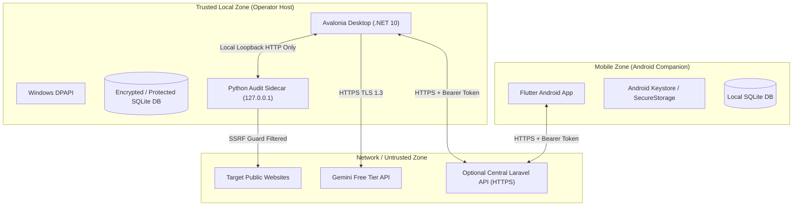

# TKS LeadPilot — Security Architecture & Privacy Specification

**Document Version:** 1.0.0  
**Status:** Approved Specification  
**Scope:** Windows Desktop, Android Mobile, Python Sidecar, Central Server  

---

## 1. Threat Model & Security Boundaries

---

## 2. Server-Side Request Forgery (SSRF) Defense

The crawler and website inspection components MUST NOT be weaponized to probe internal infrastructure.

### Mandatory Rules:
1. **Loopback Block:** Reject `127.0.0.0/8`, `::1`, `localhost`.
2. **Private Network Block:** Reject `10.0.0.0/8`, `172.16.0.0/12`, `192.168.0.0/16`.
3. **Cloud Metadata Block:** Reject `169.254.169.254` and all `169.254.0.0/16` addresses.
4. **Internal DNS Block:** Reject hostnames ending in `.local`, `.internal`, `.lan`, `.corp`, or unresolvable internal suffixes.
5. **Pre-Connect Validation:** Hostnames are resolved to IP addresses via system DNS, and every IP is validated against the CIDR blacklist before socket creation.
6. **Redirect Re-Validation:** On HTTP 301/302 redirects, the destination URL must undergo identical DNS resolution and blacklist evaluation.

---

## 3. Secret & Credential Storage

| Platform | Secret Type | Storage Mechanism | Security Level |
|---|---|---|---|
| **Windows Desktop** | Gemini API Key, Places Key, Master PIN | `ProtectedData.Protect` (Windows DPAPI, `DataProtectionScope.CurrentUser`) | Hardware / OS account encrypted |
| **Android Mobile** | API Bearer Token, Device UUID | Android Keystore via `flutter_secure_storage` | Hardware-backed TEE / StrongBox |
| **Central Laravel** | DB Password, Sanctum Keys | `.env` outside webroot, environment variables | OS filesystem permissions |

---

## 4. Privacy & Safe Outreach

1. **Lawful Basis & Consent:** Lead records distinguish between public business contacts and personal contacts. Direct promotional marketing adheres to applicable regional standards.
2. **Suppression List:** Unsubscribed contacts and "Do Not Contact" requests are enforced locally and synced globally. The system blocks draft generation or outreach to suppressed records.
3. **Zero Plaintext Credentials in Logs:** RegEx sanitizers redact keys, tokens, and passwords from all application log streams.
