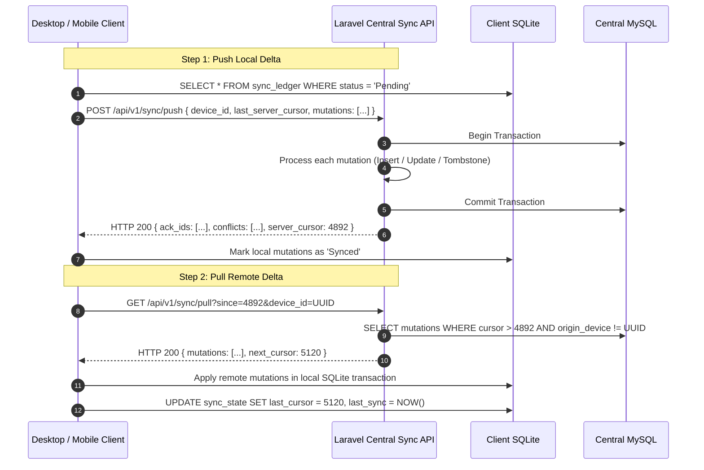

# TKS LeadPilot — Bidirectional Synchronization Protocol & Design

**Document Version:** 1.0.0  
**Status:** Approved Specification  
**Architecture:** Client-Server Delta Sync (Local-First)  

---

## 1. Sync Philosophy & Guarantees

1. **Local Autonomy:** Clients (Desktop & Mobile) read and write to local SQLite instances at all times. Network outages never interrupt local workflows.
2. **Deterministic UUIDs:** All entities are keyed by UUIDv4 generated at creation time.
3. **Delta-Only Exchange:** Only records modified since the client's last synchronization cursor are transmitted.
4. **No Silent Data Loss:** In the event of conflicting edits across devices, the server archives the displaced version in `sync_conflicts` for operator review while applying deterministic resolution.
5. **Idempotent Transactions:** Re-sending a sync payload (e.g. after a dropped network connection) produces identical state without creating duplicate records.

---

## 2. Sync Protocol Flow

---

## 3. Conflict Resolution Strategy

When an entity is modified concurrently on both Desktop and Mobile:
1. **Resolution Rule:** Field-level merge where possible; entity-level **Last-Write-Wins (LWW)** using the higher `client_updated_at` UTC timestamp as the primary tiebreaker.
2. **Conflict Preservation:** The server creates an entry in `sync_conflicts` storing:
   - `entity_type` (e.g. `Business`)
   - `entity_id`
   - `winning_payload`
   - `losing_payload`
   - `conflict_time`
   - `status` (`AutoResolved`, `ManuallyReviewed`)
3. **UI Notification:** The desktop application flags unresolved conflicts in the Sync Manager screen, allowing the operator to review and restore previous values if desired.

---

## 4. Tombstone Handling

When a record is deleted locally:
1. It is not immediately dropped with `DELETE FROM businesses`.
2. It is updated: `is_deleted = 1, deleted_at = NOW(), version = version + 1`.
3. The sync push transmits this deletion tombstone to the central server and other devices.
4. After 30 days of tombstone propagation across all registered devices, a background vacuum task permanently purges tombstoned records.
