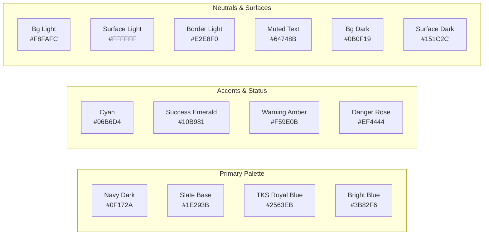

# TKS LeadPilot — UX Architecture & Design System

**Document Version:** 1.0.0  
**Status:** Approved Specification (Stage 2)  
**Target Clients:** Windows Desktop (Avalonia C#) & Android Mobile (Flutter Dart)  
**Design Philosophy:** Data-dense, clean, modern SaaS ergonomics with zero visual clutter.  

---

## 1. Brand Identity & Design Tokens

TKS LeadPilot incorporates **TheKhanSoft (TKS)** enterprise identity: tech-forward, authoritative, high-contrast, and focused on information density without overwhelming the operator.

### 1.1 Color Tokens



#### Exact Hex Specifications:
| Token Name | Light Theme Hex | Dark Theme Hex | Semantic Usage |
|---|---|---|---|
| `Color.Brand.Primary` | `#1E40AF` (Blue 800) | `#3B82F6` (Blue 500) | Primary actions, key headers, brand accents |
| `Color.Brand.Secondary` | `#0284C7` (Sky 600) | `#38BDF8` (Sky 400) | Secondary highlights, active tabs |
| `Color.Bg.App` | `#F8FAFC` (Slate 50) | `#0B0F19` (Deep Navy) | Main window/scaffold background |
| `Color.Bg.Surface` | `#FFFFFF` (White) | `#151E2E` (Navy Card) | Cards, modals, side panels, data grids |
| `Color.Bg.Sidebar` | `#0F172A` (Slate 900) | `#080C14` (Darkest) | Persistent navigation sidebar |
| `Color.Border.Default` | `#E2E8F0` (Slate 200) | `#26334A` (Slate 700) | Dividers, card borders, grid cell lines |
| `Color.Text.Primary` | `#0F172A` (Slate 900) | `#F8FAFC` (Slate 50) | High-contrast body, titles, table cells |
| `Color.Text.Secondary` | `#64748B` (Slate 500) | `#94A3B8` (Slate 400) | Subtitles, labels, metadata, timestamps |
| `Color.Status.Success` | `#10B981` (Emerald) | `#34D399` (Emerald) | Websites active, high scores (85+), approvals |
| `Color.Status.Warning` | `#F59E0B` (Amber) | `#FBBF24` (Amber) | Moderate scores (50-69), pending drafts |
| `Color.Status.Danger` | `#EF4444` (Rose) | `#F87171` (Rose) | Missing sites, severe audit fails, SSRF block |
| `Color.Status.Info` | `#0EA5E9` (Sky) | `#38BDF8` (Sky) | Information notes, sync queued |

---

### 1.2 Typography Scale

The font family standard is **Inter** or system sans-serif (`Segoe UI Variable` on Windows 11; `Roboto` on Android).

| Style Name | Size (pt/sp) | Weight | Line Height | Usage |
|---|---|---|---|---|
| `Display.Large` | 24 | SemiBold (600) | 32 | Dashboard main counters, screen main titles |
| `Title.Large` | 18 | SemiBold (600) | 24 | Card headers, section titles, modal titles |
| `Title.Medium` | 14 | SemiBold (600) | 20 | Table column headers, tab labels, list group headers |
| `Body.Regular` | 13 | Regular (400) | 18 | Primary table text, notes, detail values |
| `Body.Small` | 11 | Regular (400) | 16 | Secondary metadata, timestamps, badge labels |
| `Code.Regular` | 11 | Medium (500) | 16 | Monospace URLs, IP addresses, JSON snippets |

---

### 1.3 Spacing & Layout Grid Scale

Using an **8-point base scale** (with 4pt micro-steps):
- `Space.2XS`: 2px (micro borders, fine divider offsets)
- `Space.XS`: 4px (badge padding, icon-text gaps)
- `Space.SM`: 8px (dense table cell padding, chip spacing)
- `Space.MD`: 16px (standard card padding, form input spacing)
- `Space.LG`: 24px (section margins, master-detail splitter gaps)
- `Space.XL`: 32px (page margins on desktop)

---

## 2. Desktop UX Shell & Navigation (Avalonia UI)

The desktop experience is divided into three zones:
1. **Collapsible Sidebar (Left, 220px / 64px compact):** Persistent top-level navigation.
2. **Global Header (Top, 48px):** Search bar, AI Free Quota tracker, sync indicator, emergency pause toggle, and profile.
3. **Workspace Canvas (Center-Right):** Adaptive data-dense workspace with support for SplitPanes (Master-Detail).

```text
+---------------------------------------------------------------------------------------------------+
|  [TKS LOGO] LeadPilot  |  [Global Search: Leads, Domains, Cities...]  |  AI: 142/1200 [Sync: OK]  |
+------------------------+--------------------------------------------------------------------------+
|  📊 Dashboard          |  BUSINESS DIRECTORY (1,420 Records)       [+ New] [Import] [Export] [...]  |
|  🔍 Discover Leads     +----------------------------------------------------+---------------------+
|  🏢 Businesses  [*]    | [Search Name/City] [Category v] [Score v] [Stage v] | BUSINESS DETAILS    |
|  🌐 Web Intelligence   +----+------------------+----------+-------+---------+ Company: Apex Dental|
|  🔬 Website Audits     | [] | Name             | City     | Score | Stage   | Domain: apexdental.pk|
|  🤖 AI Studio          +----+------------------+----------+-------+---------+ Phone: +92 42 357...|
|  🎯 Lead Scoring       | [] | Apex Dental Care | Lahore   | 88 🟢 | Qualif. | Website: None ⚠️    |
|  💼 TKS Services       | [] | Sunrise Hospital | Karachi  | 74 🟢 | Review  | Score: 88/100 🔥    |
|  📈 CRM Pipeline       | [] | Green Valley Cafe| Islamabad| 42 🟡 | Contact | ------------------- |
|  ✉️ Message Studio     | [] | Metro Logistics  | Faisalab.| 18 ⚪ | Discov. | AUDIT SUMMARY:      |
|  📑 Reports            | [] | Urban Tech Labs  | Lahore   | 92 🟢 | Propos. | No SSL Certificate  |
|  🔌 Integrations       +----+------------------+----------+-------+---------+ Slow Mobile FCP (4s)|
|  ⚙️ Settings           | Showing 1 - 25 of 1,420 rows            < 1 2 3 > | [Draft Proposal]   |
+------------------------+----------------------------------------------------+---------------------+
```

---

## 3. Detailed Screen Blueprints

### 3.1 Executive Dashboard
```text
+---------------------------------------------------------------------------------------------------+
| DASHBOARD OVERVIEW                                                 [Refresh] [Date: Last 30 Days] |
+---------------------------------------------------------------------------------------------------+
|  +--------------------+  +--------------------+  +--------------------+  +---------------------+  |
|  | DISCOVERED         |  | WITH WEBSITE       |  | HIGH OPPORTUNITY   |  | DRAFTS PENDING      |  |
|  | 2,845              |  | 1,120 (39%)        |  | 384 Leads          |  | 12 Messages         |  |
|  | +180 this week     |  | 1,725 No Website ⚠️|  | Score > 75 🟢      |  | Requires Sign-off 🔔|  |
|  +--------------------+  +--------------------+  +--------------------+  +---------------------+  |
|                                                                                                   |
|  +--------------------------------------------+  +---------------------------------------------+  |
|  | LEADS BY PIPELINE STAGE                    |  | RECENT AUDIT FINDINGS                       |  |
|  | Discovered       [============] 1,420      |  | • Apex Dental: Missing HTTPS / Mobile slow  |  |
|  | To Review        [======] 680              |  | • Care Pharmacy: No Website detected        |  |
|  | Qualified        [====] 410                |  | • Horizon Law: Lighthouse Perf 24/100 🔴    |  |
|  | Contacted        [===] 220                 |  | • Blue Ocean: Broken internal links (14)    |  |
|  | Proposal Sent    [=] 75                    |  |                                             |  |
|  | Won              [=] 40 🎉                 |  | [View All 245 Completed Audits ->]          |  |
|  +--------------------------------------------+  +---------------------------------------------+  |
+---------------------------------------------------------------------------------------------------+
```

---

### 3.2 Business Database & Deduplication Screen
- **Toolbar:** Filter bar (Category, City, Website status, Min Score, Pipeline Stage), Bulk action dropdown (Change Stage, Tag, Export, Deduplicate), Search query input.
- **DataGrid Features:**
  - Multi-column sort (Click header).
  - Column reordering & resizing.
  - Multi-row selection with checkbox column.
  - Sticky header row with alternating row shading (`#FFFFFF` / `#F8FAFC`).
  - Score badge indicator pills (Green for 70+, Yellow for 50-69, Gray for <50).
- **Split Inspector:** Slides in from the right when any row is clicked. Displays full contact list, quick notes, audit teaser, and one-click actions: `[Audit Website]`, `[Draft Message]`, `[Add Task]`.

---

### 3.3 Website Audit Inspector Screen
```text
+---------------------------------------------------------------------------------------------------+
| AUDIT REPORT: https://apexdental.pk                                   [Re-Audit] [Export PDF]     |
| Business: Apex Dental Care | Last Audited: 2026-11-15 14:22 UTC | Engine: Playwright + Lighthouse |
+---------------------------------------------------------------------------------------------------+
|  OVERALL AUDIT SCORE: 42/100 🔴 (Critical Opportunities Identified)                               |
|  +-------------------+  +-------------------+  +-------------------+  +------------------------+  |
|  | PERFORMANCE       |  | SEO               |  | ACCESSIBILITY     |  | SECURITY HYGIENE       |  |
|  | 28/100 🔴         |  | 62/100 🟡         |  | 54/100 🟡         |  | 25/100 🔴 (No HTTPS)   |  |
|  +-------------------+  +-------------------+  +-------------------+  +------------------------+  |
|                                                                                                   |
|  PRIORITIZED EVIDENCE-BACKED FINDINGS (14 Issues Found)                                           |
|  [All (14)] [Critical (3)] [High (4)] [Medium (5)] [Low (2)]                                      |
|  +---------------------------------------------------------------------------------------------+  |
|  | 🔴 CRITICAL | Missing TLS / HTTPS Encryption                                                |  |
|  |    Evidence: Website loads over unencrypted http:// port 80. Browser warns visitors.        |  |
|  |    Business Impact: Patients hesitate to submit appointment forms; Google flags insecure.   |  |
|  |    Recommended TKS Service: TKS Website Security & Modernization Retainer                   |  |
|  +---------------------------------------------------------------------------------------------+  |
|  | 🔴 CRITICAL | Excessive Largest Contentful Paint (LCP = 5.8s on Mobile)                     |  |
|  |    Evidence: 4.2 MB uncompressed hero banner image blocking initial page render.            |  |
|  |    Business Impact: >50% mobile bounce rate before page finishes loading.                    |  |
|  |    Recommended TKS Service: TKS Core Web Vitals Optimization / Modern Web Redesign          |  |
|  +---------------------------------------------------------------------------------------------+  |
+---------------------------------------------------------------------------------------------------+
```

---

### 3.4 CRM Pipeline & Outreach Message Studio
- **Pipeline Kanban:** Drag-and-drop columns from `Discovered` through `Won`. Each card shows Business Name, City, Lead Score badge, and Next Follow-up Date.
- **Message Studio:**
  - Split view: Left column displays message templates (e.g. *"Audit Findings Teaser"*, *"Website Modernization Pitch"*, *"Follow-Up Note"*).
  - Center column displays rich-text draft editor with live token interpolation.
  - Right column shows **Approval Queue Banner**:  
    > ⚠️ **MANDATORY APPROVAL REQUIRED**  
    > Recipient: `Dr. Tariq Mahmood <tariq@apexdental.pk>`  
    > Channel: `Email` | Source: `Public Contact Page`  
    > `[Approve & Queue]` `[Reject / Edit]` `[Cancel]`

---

## 4. Mobile UX & Ergonomics (Flutter Android)

The Android companion application is built for agile field work and lead reviews:
- **Navigation:** Bottom Navigation Bar with 4 primary destinations:
  1. `Dashboard` (Quick daily stats & follow-up counters)
  2. `Leads` (Searchable, filterable list with high-contrast score badges)
  3. `Tasks` (Due today, overdue, scheduled follow-up calls)
  4. `Approvals` (Review and sign-off on outreach drafts queued on desktop)
- **Ergonomics:**
  - One-handed thumb reachability: Floating Action Button (FAB) for `[+ Add Lead]`, bottom-sheet filters.
  - Swipe Actions: Swipe right on a lead card to update stage; swipe left to schedule a follow-up.
  - Direct Phone/WhatsApp Integration: Tapping phone number launches native dialer or official WhatsApp chat.

---

## 5. Reusable Component States

| State | Visual Pattern | Action Trigger |
|---|---|---|
| **Empty State** | Centered muted illustration, friendly headline, explanatory text, and primary call-to-action button (e.g., *"No businesses discovered yet — [Start Discovery Job]"*). | Explicit button |
| **Loading State** | Skeleton shimmer placeholders matching exact card/table geometry. No blocking modal spinners. | Background task |
| **Error State** | Non-invasive inline alert banner with error code, human-readable cause, and `[Retry]` + `[Copy Diagnostics]` buttons. | Network / API failure |
| **Offline State** | Persistent slim amber top banner: *"Offline Mode — All changes saved locally to SQLite and queued for sync."* | Connectivity change |
| **AI Quota Warning** | Badge changes from Green (`AI: 24/1200`) to Amber (`AI: 1180/1200`) to Red (`AI Free Quota Reached — Paused until 00:00 UTC`). | Quota threshold |
